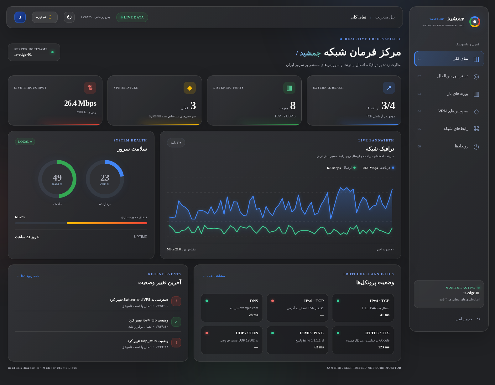
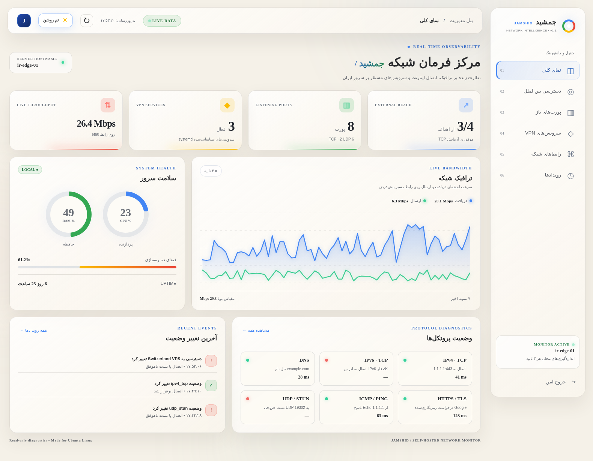

<div align="center">
  
  <h1>جمشید | JAMSHID</h1>
  <p><strong>رادار هوشمند وضعیت شبکه برای سرورهای Ubuntu</strong><br/>Network Radar &amp; Connectivity Observatory for Ubuntu</p>
  <p>
    
    
    
    
  </p>
  <p><a href="docs/index.html"><strong>🌐 فایل صفحه معرفی</strong></a> &nbsp; · &nbsp; <a href="#-نصب-روی-ubuntu"><strong>⚡ نصب</strong></a> &nbsp; · &nbsp; <a href="README.en.md"><strong>🇬🇧 English</strong></a> &nbsp; · &nbsp; <a href="راهنمای-فارسی.md"><strong>📚 راهنمای فارسی</strong></a></p>
</div>

---

### 🛰️ جمشید چیست؟

**جمشید** یک داشبورد خودمیزبان (*Self-hosted*) برای مشاهده وضعیت شبکه و آزمایش اتصال **از داخل سرور Ubuntu** است. برای سناریویی طراحی شده که سرور در ایران قرار دارد و می‌خواهی در یک محیط بصری، وضعیت دسترسی خروجی آن به سرویس‌ها و VPSهای خارج از کشور را مقایسه کنی.

نمایشگر راست‌به‌چپ، با فونت **Vazirmatn**، کارت‌های شیشه‌ای و رنگ‌های گوگل است. تم زغالی `#202124` و تم استخوانی `#F5F1E8` دارد.

<p align="center"><br/><sub>نمای داشبورد دارک — تصویر با داده‌های آزمایشی، نه مانیتورینگ زنده سرور شما</sub></p>

<details><summary><strong>☀️ مشاهده تم روشن</strong></summary><p align="center"></p></details>

### ✨ قابلیت‌ها

| قابلیت | توضیح |
|---|---|
| 📡 **پایش لحظه‌ای** | CPU، RAM، Disk، ترافیک ورودی/خروجی و وضعیت رابط‌های شبکه |
| 🔌 **پورت‌ها** | سوکت‌های TCP/UDP در حال شنود و اطلاعات Bind و IPv4/IPv6 |
| 🌍 **تست ارتباط خارجی** | TCP handshake و Ping جداگانه برای مقصدهای قابل تنظیم |
| 🔎 **پروب‌های شبکه** | DNS، HTTPS، IPv4، IPv6 و UDP/STUN (با محدودیت‌های هر تست) |
| 🛡️ **سرویس‌های VPN** | تشخیص وضعیت سرویس‌های شناخته‌شده و رابط‌های تونل، نه تضمین عملکرد واقعی تونل |
| 🔐 **دسترسی امن** | احراز هویت، Web Path اختصاصی، HTTPS با Let's Encrypt، ابزار مدیریت ترمینالی |
| 🎨 **رابط کاربری** | دارک زغالی، لایت استخوانی، Vazirmatn و Glassmorphism |

> **محدودیت مهم:** شنود روی یک پورت به معنای قابل‌دسترسی‌بودن آن از اینترنت نیست. همچنین موفقیت TCP/ICMP خروجی به معنی عملکرد قطعی تمام VPNها یا بازبودن مسیر ورودی از خارج نیست. برای تست ورودی از خارج، به Agent روی یک VPS خارجی نیاز است.

### ⚡ نصب روی Ubuntu

**پشتیبانی هدف:** Ubuntu 22.04 / 24.04 / 26.04 با `systemd` و Nginx. پیش از نصب، یک دامنه اختصاصی با رکورد DNS صحیح آماده کن. فایل‌های مخزن را روی سرور دریافت کن:

```bash
sudo apt update && sudo apt install -y git
git clone https://github.com/ArioBarzanMoradi/Jamshid-Radar.git
cd Jamshid-Radar
sudo bash scripts/install.sh
```

`USERNAME` را با نام کاربری واقعی GitHub خودت جایگزین کن. نصاب نام دامنه، Web Path و نام کاربری/رمز عبور را می‌پرسد.

**راه‌اندازی SSL** (بعد از دسترسی دامنه از بیرون روی پورت 80):

```bash
sudo bash scripts/enable-ssl.sh jamshid.example.com
sudo certbot renew --dry-run
```

**نمونه آدرس داشبورد:** `https://jamshid.example.com/your-secret-path/`

**تغییر رمز و نام کاربری:**

```bash
sudo jamshidctl passwd
sudo jamshidctl username
sudo jamshidctl rotate-sessions
```

**توجه:** اگر قبلاً نسخه 1.0 یا 1.1 را نصب کرده‌ای، نصب‌کننده عمداً روی سرویس موجود بازنویسی نمی‌کند. دستورهای ارتقا در [مستندات اصلی](README.technical.md) آمده‌اند.

### 🧭 معماری

```text
                      ┌───────────────────────────┐
                      │  Browser / JAMSHID UI     │
                      │ HTTPS + Auth + Secret Path│
                      └──────────────┬────────────┘
                                     │
                               Nginx reverse proxy
                                     │
                      ┌──────────────▼────────────┐
                      │ FastAPI on 127.0.0.1      │
                      │ Port 18764 / read-only    │
                      └──────────┬───────┬────────┘
                                 │       │
                       Linux interfaces │   Outbound probes
                         ss, ip, psutil │   TCP / ICMP / DNS / HTTPS / STUN
                                 │       └──────────► Foreign VPS / services
                                 ▼
                           Ubuntu server
```

### 🗂️ ساختار مخزن

```text
app/                 # داشبورد و منطق مانیتورینگ
scripts/             # نصب، SSL، مدیریت حساب کاربری
tests/               # تست‌های بک‌اند
docs/                # سایت آماده انتشار با GitHub Pages
assets/              # تصویرهای README و لوگو
README.md            # معرفی فارسی
README.en.md         # معرفی انگلیسی
README.technical.md  # مستندات فنی اصلی نسخه 1.1
راهنمای-فارسی.md      # راهنمای نصب و عیب‌یابی
GITHUB-PUBLISH-FA.md # مراحل انتشار مخزن و سایت
```

### 🔒 امنیت و حریم خصوصی

- فایل واقعی `/etc/network-radar/config.json`، رمزها، کلیدهای خصوصی و اطلاعات VPS را در GitHub منتشر نکن.
- سرویس با کاربر غیرریشه اجرا می‌شود و خود داشبورد دسترسی تغییر فایروال یا تنظیمات VPN را ندارد.
- بدون SSL وارد پنل نشو. **GitHub Pages فقط سایت معرفی است، نه خود داشبورد مانیتورینگ.**
- انتشار سورس کد در مخزن عمومی با انتشار داده‌های عملیاتی یک سرور متفاوت است.

### 🛠️ وضعیت پروژه

**v1.1 — نسخه اولیه قابل نصب**، با مانیتورینگ محلی و پروب‌های خروجی. بهبودهای پیشنهادی: Agent خارجی برای آزمون اتصال ورودی، تاریخچه پایدار و هشدارها. در [CHANGELOG](CHANGELOG.md) تغییرات را دنبال کن.

**مجوز انتشار:** Apache License 2.0، مطابق فایل LICENSE مخزن.
